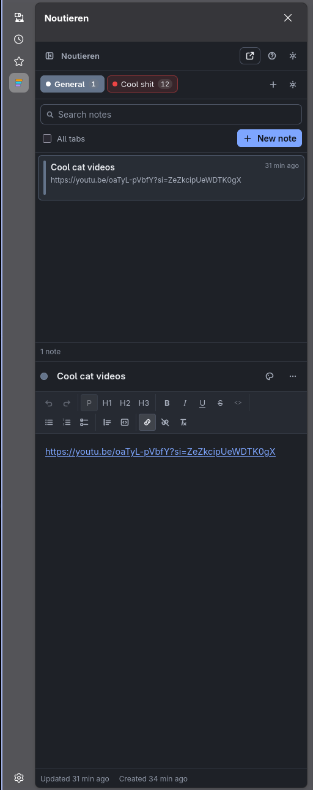
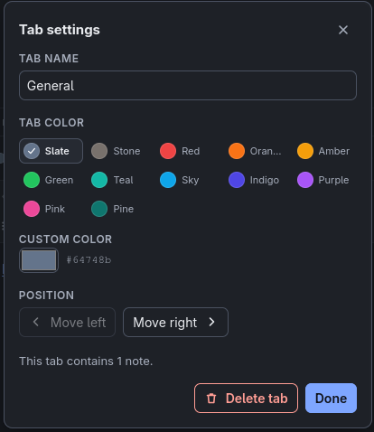
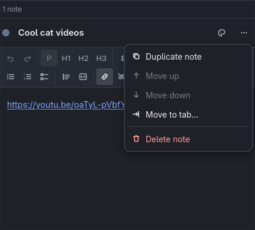

# Noutieren

A notes extension for Firefox and Chrome. Your notes sit in tabs that you name and colour,
and they never leave your computer.

I wanted somewhere to put a thought without opening a document or making an account, so I
built one. In Firefox it lives in the sidebar. In Chrome it opens from the toolbar.



## Install

- [Firefox](https://addons.mozilla.org/en-US/firefox/addon/noutieren-notes/), version 142 or
  newer
- [Chrome](https://chromewebstore.google.com/detail/noutieren/fehabengonhjmgghempjpcgfkggppknf),
  version 111 or newer

## What it does

- Notes are grouped in tabs. Each tab and each note can have its own name and colour.
- Write with headings, lists, checklists, quotes, code and links. Everything saves as you type.
- Search one tab or all of them.
- Set a reminder on a note and get a notification when it's due, even with Noutieren closed.
- Pin a tab or a note to a website, so it only shows up while that site is open.
- Deleted notes stay in Recently deleted for 30 days, in case you want them back.
- Save everything to a backup file, and load it again later or on another computer.
- Light and dark mode.

| Tab settings                                                                                                                                            | Note menu                                                                                                                  |
| ------------------------------------------------------------------------------------------------------------------------------------------------------- | -------------------------------------------------------------------------------------------------------------------------- |
|  |  |

## Your notes stay with you

- No account, no sync, no ads and no tracking.
- Noutieren never connects to the internet. Your notes are stored in your browser and
  nowhere else.
- It can't read the websites you visit.
- Reminder notifications only show a note's title.

When you install it, it asks for three permissions, and none of them shows a prompt:
`storage` and `unlimitedStorage` to save your notes, and `alarms` so reminders go off on time.
Two more are only asked for if you use the feature that needs them: `tabs` for pins, and
`notifications` for reminders. [PRIVACY.md](PRIVACY.md) has the details.

Since your notes only exist in your browser, make a backup now and then. Deleting the
extension deletes the notes too.

## Reminders

Open a note's menu (the three dots) and choose Remind me. Pick in an hour, this evening,
tomorrow morning, next week, or any date and time.

When the time comes you get a notification. Click it to open the note. If you miss it, it
goes off again every few minutes until you open the note, for up to an hour, and the toolbar
button shows how many reminders are waiting. You can change how often, or turn the repeats
off, under "If you miss it".

## Pin to URL

A pinned tab or note only shows up while a certain website is open, like notes about a video
that only appear on YouTube. Set it in Tab settings or in a note's menu.

| Pin                                           | Shows up on            |
| --------------------------------------------- | ---------------------- |
| `https://www.youtube.com/`                    | the YouTube home page  |
| `https://*.youtube.com/*`                     | every page on YouTube  |
| `https://www.youtube.com/watch?v=eDQtUwad5vg` | that one video         |
| `example.com/docs/*`                          | every page under /docs |

A `*` means "anything goes here". Noutieren never adds one for you: type it yourself, or tick
"Also match everything under this address". You can leave out the `https://`. Before you add
a pin, it shows you exactly what will be saved.

A pin only hides things. When a pin is hiding something, a button in the tab strip says how
many, and one click shows everything again.

To know which site you're on, pins need the `tabs` permission. Noutieren only asks for it
when you press Enable Pin to URL, and it never saves or sends the address. In Chrome the
popup can't ask for a permission, so a tab opens to ask instead.

## Backups

Settings > Export all data saves everything to one file. Settings > Import data loads it back,
either next to the notes you have or in place of them. If you replace them, Noutieren first
downloads a backup of what you had.

If you haven't made a backup in three weeks, Noutieren reminds you.

## Keyboard shortcuts

| Keys                            | What it does            |
| ------------------------------- | ----------------------- |
| Ctrl + N                        | New note                |
| Ctrl + Shift + N                | New tab                 |
| Ctrl + K                        | Search                  |
| Ctrl + S                        | Save now                |
| Ctrl + B, Ctrl + I, Ctrl + U    | Bold, italic, underline |
| Ctrl + Shift + S                | Strikethrough           |
| Ctrl + E                        | Code                    |
| Ctrl + Z, Ctrl + Shift + Z      | Undo, redo              |
| Esc                             | Close a dialog or menu  |
| Left or right arrow, then Enter | Switch to another tab   |

On a Mac, use Cmd instead of Ctrl. Firefox sometimes keeps Ctrl + N for itself and opens a
new window instead; the New note button always works. The ? button in Noutieren shows this
list too.

## Building it yourself

You need Node.js 22 or newer.

```bash
npm install
npm run firefox       # builds it and opens a test copy of Firefox with it installed
npm run build         # Firefox build in dist/
npm run build:chrome  # Chrome build in chrome_version/dist/
npm run check         # types, lint, tests and both builds
```

[DEVELOPING.md](DEVELOPING.md) has the rest: how the code is laid out, how notes are stored,
the two names you must never change, and how to release a new version.
[BUILDING.md](BUILDING.md) shows how to rebuild the exact files that are in the stores.

Made with React, TypeScript, Vite, Tiptap and Dexie. MIT license.
